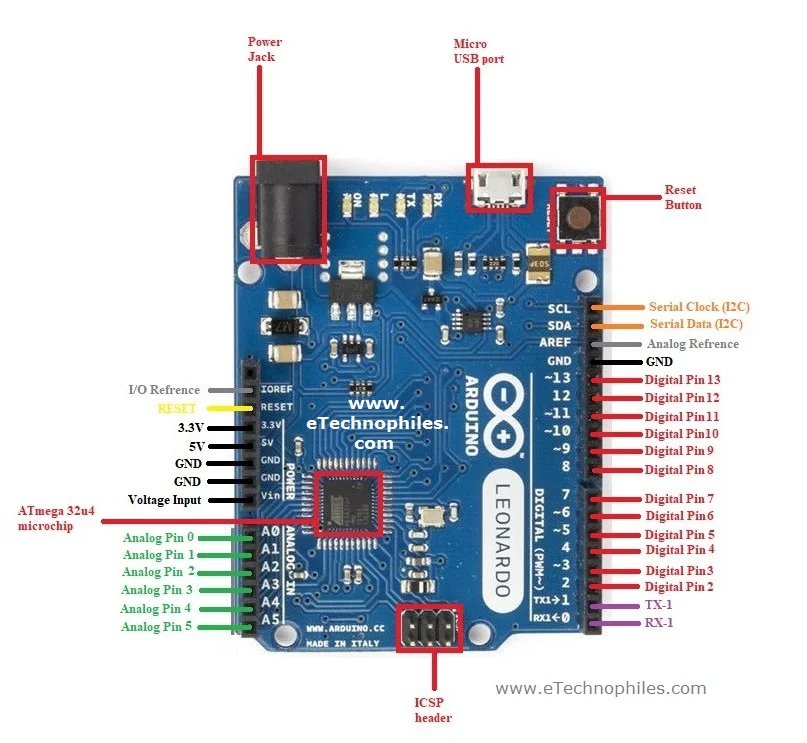
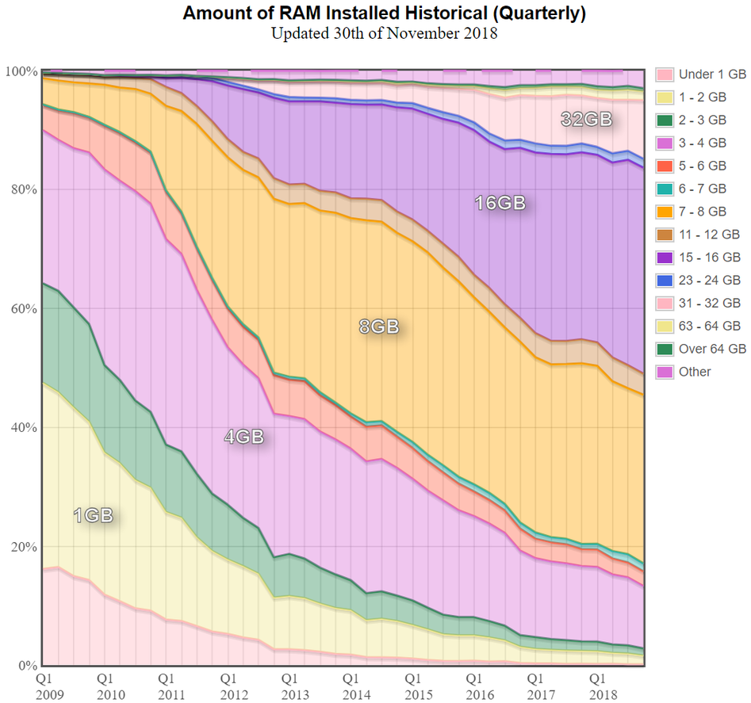
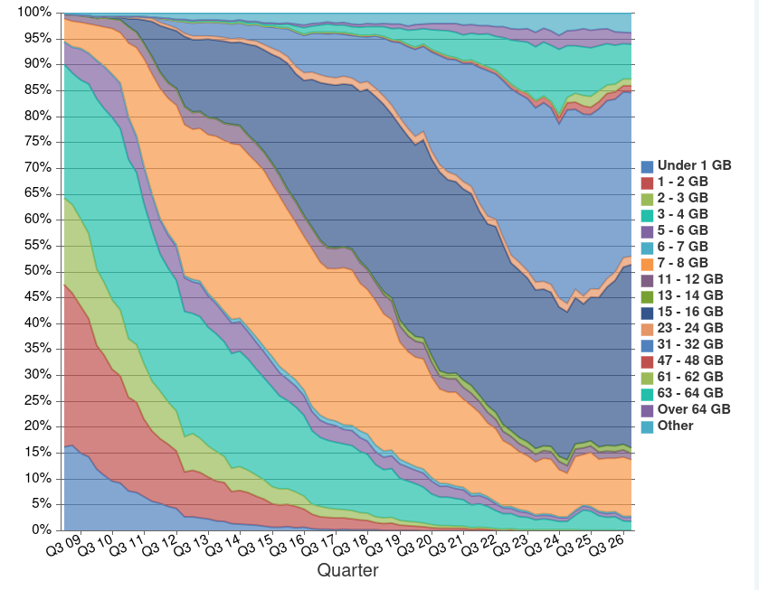
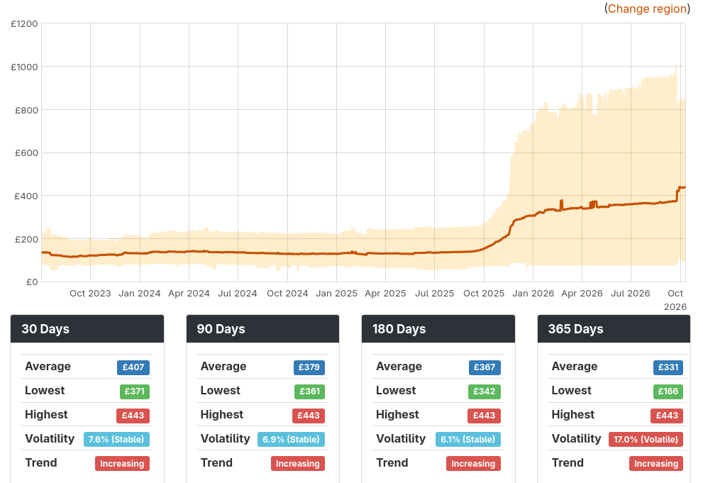

## Learning Outcomes

- State the different types of computer memory --- **registers, cache,
  main memory, disk**.
- Recall the **memory hierarchy**.
- State the differences in size and speed of the different types of
  memory, and the reasons behind this.

# But first... a side rant

# From Ed Rogers...

# About Generative AI

# Ed Rogers Side Rant {.smaller}

> When coding can happen faster than the programmer can think, it makes things without thought. When all friction is removed from the act of creation, creation becomes cheap. How many great acts of creation can you think from history were arrived at without friction? How many of them would still have been possible if the friction had been removed for the artist in advance? That doesn't mean we should cause always resist automation, but we should always be wary of it. GK Chesterton said we should know why a fence was put there in the first place before we tear it down. Programming has always had barriers to overcome, more than were strictly limitations of the machines --- otherwise why are we still teaching low level languages rather than just Scratch and Python? How sure are we that none of those old barriers to overcome had any benefit or function?

--- Ed Rogers, 16/10/26

## Recap: the CPU

:::: {.cell layout-align="center"}
::: cell-output-display
{fig-align="center"
fig-alt="diagram of Von Neumann architecture showing five components described on the next page"
width="50%"}
:::
::::

# Memory

## Memory structure

:::: {.cell layout-align="center"}
::: cell-output-display
{fig-align="center"
fig-alt="diagram showing computer memory structure: registers (on cpu), memory (RAM), disk and network"
width="80%"}
:::
::::

## Memory structure

:::: {.cell layout-align="center"}
::: cell-output-display
{fig-align="center"
fig-alt="memory hierarchy diagram: registers, cache, memory, disk; speed decreases, size increases"
width="90%"}
:::
::::

## Registers

- Small blocks of memory located **on the CPU** itself.

- Used to store intermediate values as the CPU works on them.

- Very fast, direct access by the CPU with no latency.

- Examples: **IR**, **PC**, **accumulator**.

  Modern CPUs often have severaal registers.

- Fastest and most expensive type of memory

- Very limited capacity -- in the order of **bytes**.

## Cache

- Small, fast memory located **claso to** the CPU.

- Intermediate storage between CPU and main memory:

  smaller and faster than main memory, slower and larger than registers.

- Multiple levels of cache:

  *L1* is the **fastest**, **smallest** and **closest** to the CPU.

- Still **expensive**, therefore **limited size** -- in the order of
  **kilo to mega-bytes**.

## Main memory

- *Random access memory* --- each byte can be accessed with the same
  latency.

- **Very slow** in comparison to cache.

- Comparatively **large** capacity -- in the order of **giga-bytes**.

- Data and programs are **loaded into memory** from disk.

## Volatile Memory

- Registers, cache and main memory are **volatile**:

  data is lost when power is lost.

## Disk

- The **slowest** and **largest** type of memory.

  Much slower than main memory.

- **Persistent** storage: data is preserved if power is lost.

- Punched cards, then magnetic tape were used in early computers.

- Later, *magnetic spinning disks*, hard disk drives (HDDs), were used.

- Modern computers use *flash memory*: solid state drives (SSDs).

## Network

- Allows access to data on **other computers**.
- Early machines used *coaxial cable*, later *twisted pair Ethernet*.
- Modern computers use *fibre-optic cable* or *radio waves* Wi-Fi.
- Orders of magnitude slower than disk.

## Laptops, desktops {.smaller}

- **Intel Core I5**:

  - First released in 2010.
  - Clock speed of **2.5GHz**, turbo-boost of **3.2Ghz**.
  - **8MB** of cache.

- **Intel Core 7** 250U:

  - First released in Quarter 1, 2025.
  - Maximum clock speed of **5.40GHz**.
  - **12M** of cache.

::: notes
2010 vs 2025 laptop
2.5GHz turbo to 3.2 vs max 5
8M v 12M cache
:::

## The trend? 

- Complex instruction set architecture (CISC), consumes around
  **20-80W** of power.

- Memory (RAM) ~~is becoming cheaper~~ (that was written before the LLM explosion):

  - Between **2GB** and **4GB** in the 2010s,
  - Common to see **16GB** in modern laptops.
  - **DDR4** (*dourbe data random access memory*): high bandwidth with
    synchronous access for read and write, released in 2014.

- SSDs are commonplace, unlikely to find a spinning HDD in a modern
  computer.

## Phones, microcontrollers and Raspberry Pis {.smaller}

- Typically ARM processors with **lower power consumption**.

- **Motorola Moto G**:

  - **8 cores**: 2 x **2.0GHz** *Cortex-A78* plus 6 x **1.8GHz**
    *Cortex-A55*
  - **32KB** of *L1 Instruction cache* plus **32KB** *L1 Data cache*.
  - **250-512 KiB** of *L2 cache*.
  - **4GB** of memory.

## Phones, microcontrollers and Raspberry Pis {.smaller}

- **Galaxy S21**:

  - **4 cores** 1 x **2.9GHz** *Cortex-X1* plus 3 x **2.8GHz**
    *Cortex-A78*
  - **8GB** memory.

::: notes
Comparing affordable vs high end smartphones froma couple of years ago. What is most noticeable? How have things changed in recent years? Why do we need so much RAM in a phone?
:::

## Phones, microcontrollers and Raspberry Pis {.smaller}

- **Raspberry Pi 4 / 400**:

  - *Broadcom BCM2711*; **4 cores**, *Cortex-A72* (ARM v8) 64-bit SoC @
    **1.8GHz**.
  - **80KiB** of *L1 cache*, **512KiB** of *L2 cache*.
  - **4GB** memory.

(Happily running a couple of Chromium tabs, a number of terminal tabs and the screenreader.)

## Phones, microcontrollers and Raspberry Pis {.smaller}

- **Arduino Uno**:

  - *ATmega328P* -- **8 bit** AVR family microcontroller.
  - **16MHz** clock speed.
  - Harvard architecture (separate, **32KB** program memory).
  - **3KB** program memory.
  - **2KB** of SRAM.
  - **1KB** of EEPROM (persistent storage).

(Powering your evelator sim, and...)

## S and A brought to you by...

::: columns-2
::: column

 - 2x Arduino Leonardo's

  - 32 KB flash memory for program
  - 2.5 KB SRAM for data
  - 16 MHz clock speed

:::
::: column

:::
:::

::: notes
Canute 360 prototype was originally developed on the Arduino Leonardo
Originally had one ATMega, using threading to handle input/output and control the motors
Lots of problems with multithreading, dev team printed out the code and laid it along the floor to debug. Decided to run the i/o and motor thread on its own microcontroller.
The Canute actually has 2 leonardo's on a custom PCB, two simpler PCB's on eachc side (rod lifters) and two moters in each of the 40 columns connected to the mainboard via H bridges. Also has a pi zero to power standalone mode and facilitate firmware updates. 2 beefy haptic motors and a 3.5mm audio out, connected up but not utilised in firmware.
:::

# Hungry? Let's talk about memory hierarchy

## Analogy: let's bake a cake

::::::: columns-2
::: column
Imagine you're plannning to bake a cake.

:::: {.cell layout-align="center"}
::: cell-output-display
{fig-align="center"
fig-alt="photo of a sponge cake" width="60%"}
:::
::::

- You have a **limited number of bowls** to weigh and mix ingredients,

:::
::: column

- A moderate amount of **work surface** to place items on,
- and **storage cupboards** where large bags of ingredients are kept.

:::: {.cell layout-align="center"}
::: cell-output-display
{fig-align="center"
fig-alt="photo of a kitchen" width="55%"}
:::
::::
:::
:::::::

::: notes
- We will build a real-world analogy of computer memory by talking about
  making a cake.
- Mixing bowls, spoons, measuring jug con be used to model CPU
  registers.
- The work surface can be thought of as the cache -- items can be easily
  accessed.
- The storage cupboard can be veiwed as main memory, where items can be
  readily accessed, but more time and effort is needed to locate the
  item than simply picking it up from the work surface.
:::

## Load from memory into registers

::::: columns-2
::: column
1.  **Fetch** the butter from the fridge

    and sugar from the cupboard.

2.  Measure butter and sugar into a mixing bowl.

3.  Cream together butter and sugar.

:::
::: column
:::: {.cell layout-align="center"}
::: cell-output-display
{fig-align="center"
fig-alt="photo of butter and sugar added to a mixing bowl" width="55%"}
:::
::::
:::
:::::

::: notes
1.  Fetching ingredients from cupboard / fridge is the same idea as
    loading data from main memory into the cache (work sorface).
2.  Measuring out ingredients is similar to loading values from cache
    into CPU registers (the mixing bowl).
3.  The process of creaming together butter and sugar is something like
    the CPU operating on its data in registers.
:::

## Add eggs

::::: columns-2
::: column

4.  **Fetch** eggs from the fridge...

    But you realise there are no eggs left.

5.  Fortunately, you keep chickens and they are laying well.

    Go to the end of the garden and collect some eggs.

6.  Returning from the chicken coop, you place the eggs on the **work surface**.

:::
:::column
:::: {.cell layout-align="center"}
::: cell-output-display
{fig-align="center" fig-alt="photo of eggs"
width="80%"}
:::
::::
:::
:::::

::: notes
5.  Rather than fetching from the comparatively quick main memory
    (cupboard / fridge), you have to do a "read from disk" -- walk down
    the garden, go into the chicken coop and locate the eggs. This is
    comparatively much slower than retrieving something from the nearby
    cupboard.

Little aside on pre-fetching. - Had you known in advance there were no
eggs in main memory, you could have optimised: - Ask your friend to
collect eggs while you are mixing butter and sugar. You will be ready
for the eggs, which they loaded into cache (put on the worktop), or
better still, cracked straight into the mixing bowl as they return (load
directly into registers), for your use.
:::

## Add flour and bake

::::: columns-2
::: column

7.  Fortunately, there is plenty of flour in the **store cupboard**.

8.  **Fetch** the sack of flour, weigh it into the **mixing bowl** and
    fold it into the mixture.

9.  Scoop the mixture into cake tins and **bake in the oven**.

:::
:::column
:::: {.cell layout-align="center"}
::: cell-output-display
{fig-align="center"
fig-alt="photo of a cake baking in the oven" width="95%"}
:::
::::
:::
:::::

::: notes
7, 8. Similar to the butter and sugar situation, a relatively quick read
from memory. 9. The oven is a bit like a **co-processor**. You can
offload a particular task onto it and use the main CPU to do other
things (you can prepare the butter cream / frosting while the cake bakes).
:::

## Cream and jam

::::: columns-2
::: column
10. While the cake is cooling, you decide to whip the cream.

    There is no cream or jam in the **fridge**.

11. You need to go to the **shop**.

- This takes **much longer** even than fetching eggs from the garden.
- So long that the cake is already cool.

:::
::: column
:::: {.cell layout-align="center"}
::: cell-output-display
{fig-align="center"
fig-alt="photo of a finished sponge cake with jam and cream in the middle"
width="70%"}
:::
::::

12. You return from the **shop** and place the cream and jam on the
    **work surface**.

:::
:::::

::: notes
11. is analogous to fetching data from the network.

- fetch from disk: go to the garden to retrieve eggs, stays "within the
  house" and while it takes much longer than going to the fridge /
  cupboard, it only takes a few minutes.
- going to the shop, on the other hand, is much farther and takes much
  longer. it also requires a different protocol (choosing items, paying
  for items) than fetching something locally.
- it also takes substantially longer.
:::

## Exercise: memory analogies

- Discuss whether this was a good analogy.

  What does it represent well, what does it represent poorly.

- Come up with your own analogy, indicating what represents the
  **registirs**, **cache**, **disk** and **network**.

- Share analogies and discuss what reflects computer memory well / not
  so well.

# RAM in PC's

{fig.align="center" fig.width="95%" fig.alt="RAM increasing over time, 8 and 16 GB most common, less than 1GB starting about 50% and tailing off to nothing by the end."}

::: notes
Would you / have you used a PC with 1GB or less? Which OS, and how was your experience?
:::

## RAM in PCs

::: notes
16 and 32 becoming more commonplace.
If you were buying a PC how much memory would you want / need?
Why?
:::

## RAM prices

::: notes
Prices are for the United Kingdom region and are shown in GBP.
Prices are 19.3% higher than they were 30 days ago.
The current price is 17% above the 90-day average of £379.
Price history covers the period from July 2023 to October 2026.
The data was last updated on October 10, 2026.
Please note that prices are shown without shipping costs, unless otherwise noted by the retailer.

from https://pangoly.com/en/price-trends/ram/32gb-ddr5
:::

## Exercise: alternative random access memory

- RAM prices are skyrocketing
- Come up with a creative alternative to RAM
  - It must be able to store 0's and 1's
  - think about speed of access, does it take the same length of time to access every bit
  - power, size, heat, cost

- If a technical solution is not possible, come up with a strategy to reduce RAM prices.

## But wait, that's not the whole story

- You've forgotten about GPU memory!
- Nvidia RTX 3090

  - 10,752 CUDA cores
  - 24GB Video RAM (GDDR6)

::: notes
CUDA: Nvidia's parallel computing api. (Compute uniform device architecture). General purpose computations via c++ api, for data parallel computations. Kind of vector processor.
:::

## Unified memory

- Found in, e.g., Apple silicon.

- High bandwidth memory shared by CPU, GPU and "neural processor"

- - CPU, GPU and memory on same chip, no need to copy between RAM and VRAM.

- Less memory needed overall , lower power consumption, win win win, right?

## Apple silicon

- Single bus between CPU, GPU NPU and main memory.

- Careful and clever power management needed to manage heat.

- Custom ARM architecture. 

## Apple silicon ISA {.smaller}

- 31 general purpose registers, stack pointer, prorgam counter, etc
- - 128 bit for SIMD
- Special purpose, e.g., high precision timers, microkernel level.
- Standard instruction with enhancements:
  - high throughput load and store
 - Crypto instructions:
  - AES, SHa1 / SHA256
- Linear algebra
  - fash matrix multiplication (for "AI")
  - uses special-purpose "neural processing unit".

# Next time

Operating systems
