## Objectives

::: notes
- State the **formal definition of deadlock** and give an example of a situation where deadlock occurs.
:::
- Give the three **Coffman conditions** required for deadlock to be possible.
- Overview the ways in which an OS may prevent or detect and break deadlock.

## Recap: the process lifecycle

::: notes
- One process may ask the OS to create a new one (fork or spawn),

  OS creates a process in the **new** state.

- When a process is initialised, the OS moves it to the **ready** state.

- The OS may decide to schedule (dispatch) a **ready** process,

  its state is changed to **running** and any saved data is restored (MMU, registers).

- if a process requires I/O, it requests this from the OS via a **syscall**,

  OS sets its state to **blocked** until the I/O is done, then its state i set to **ready**.

- A **running** process may be interrupted or pre-empted,

  then its data is saved and state changed to **ready**.

- When a process is finished, its state is set to **exit**,

  the OS does some cleanup before the process is deleted.
:::

:::: {.cell layout-align="center"}
::: cell-output-display
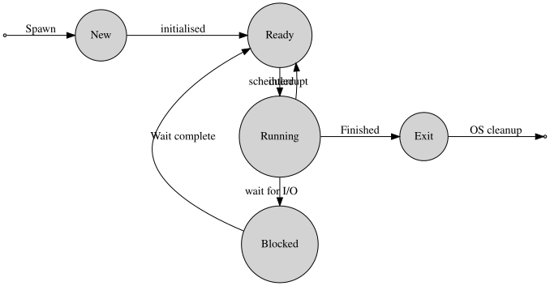{fig-align="center" fig-alt="diagram showing possible process state transitions" width="90%"}
:::
::::

# What happens when a process needs to do disk I/O?

## Example: blocking on I/O

Process is **running**.

:::: {.cell layout-align="center"}
::: cell-output-display
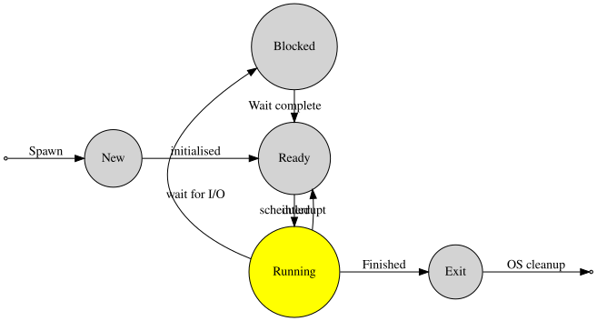{fig-align="center" fig-alt="lifecycle diagram with running highlighted" width="70%"}
:::
::::

Makes a **syscall**, requesting **I/O**.

## Example: blocking on I/O

OS moves the process to **blocked**.

:::: {.cell layout-align="center"}
::: cell-output-display
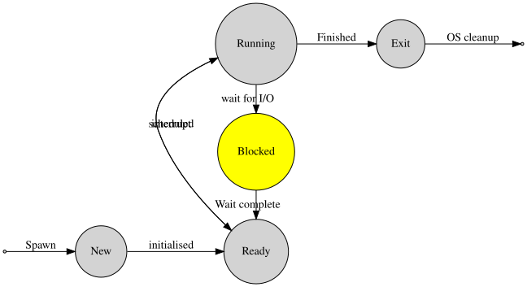{fig-align="center" fig-alt="lifecycle diagram with blocked highlighted" width="70%"}
:::
::::

Process remains **blocked** until I/O request has been completed.

## Example: blocking on I/O

When the I/O request is done, OS moves the process to **ready**.

:::: {.cell layout-align="center"}
::: cell-output-display
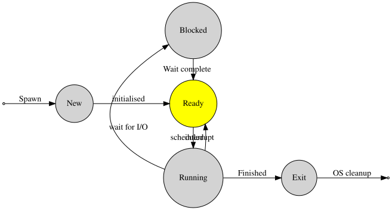{fig-align="center" fig-alt="lifecycle diagram with ready highlighted" width="70%"}
:::
::::

OS Will move the process to **running** when it is scheduled.

- Note that this may not happen immediately.

## Recap: scheduling {.smaller}

Deciding what to do next.

A good scheduler should:

1.  not give any process too much CPU, but
    not give any process too little, either (*starvation*).

2.  Give compute-heavy processes longer, larger slices of CPU time, but
    give interactive processes small slices of CPU time very often.

3.  Ensure real-time (safety-critical) processes run immediately.

4.  Ensure optimum use of hardware,
    everything should be busy, nothing should be waiting.

5.  Optimise for different types of hardware, e.g.,
    mice and printers are slow, network and disk is (comparatively) fast.

6.  Provide **predictable** behaviour, and

7.  degrade gracefully under excessive load.

8.  Run **fast**, so as to maximise time spent running user-land applications
    and **avoid thrashing**.

- Note that other resources, e.g., I/O, need scheduling, too.
  Different resource schedulers may disagree about which process to run next.

# Easy, right? Well that's not all...

## The OS also needs to

- prevent **deadlocks**,

  a group of processes all waiting for one of their number to do something.

- Process protection:

  insuring that processes cannot interfere with one another.

# Deadlock

## The Scenario

- Two keen students, Alice and Bob, sit at a desk. On the desk is one piece of paper and one pen. Both students want to take meticulous notes.
- Simultaneously, Alice grabs for the pen and Bob snatches up the paper. 
- They stare blankly at each other, realising that neither of them can take notes.
- Oscar arrives. How does he break the deadlock between Bob and Alice?
  1. What is the cause of the deadlock?
  2. How can Oscar break the deadlock?
- Where does this situation occur in computers?

## Example

::::: columns-2
::: column
- Process $P_1$ wants copy to a file from disk $A$ to disk $B$.
- Process $P_2$ wants to copy a file from disk $B$ to disk $A$.
- Only one process can access the disk at any one time.

What happens?

:::
::: column
:::: {.cell layout-align="center"}
::: cell-output-display
{fig-align="center" fig-alt="diagram of two processes with a circular wait for two resources" width="90%"}
:::
::::
:::
:::::

## Example

::::: columns-2
::: column
- $P_1$ is scheduled.

  $P_1$ is given disk $A$,

- Now $P_2$ is scheduled.

  It is given access to disk $B$.

- $P_2$ is still running.

  It requests access to disk $A$.

- Request is denied since $P_1$ has disk $A$.

  $P_2$ **blocks**, waiting for disk $A$.
:::
:::column
:::: {.cell layout-align="center"}
::: cell-output-display
{fig-align="center" fig-alt="diagram of two processes with a circular wait for two resources" width="90%"}
:::
::::
:::
:::::

## Example

- $P_1$ is scheduled.

  It requests access to disk $B$.

- The request is denied since $P_2$ has disk $B$ already.

  $P_1$ **blocks** waiting for disk $B$.

- Now **both** $P_1$ and $P_2$ are **blocked**.

  Only $P_1$ can unblock $P_2$, and only $P_2$ can unblock $P_1$.

We have a **deadlock**.

## Formal definition: deadlock

A group of processes, $D = \{P_1,\ldots,P_k\}$ is **deadlocked** if

- every process $P_i$ is **blocked**, waiting for an event $E_i$,
- but the event $E_i$ can only be caused by a process in $D$.

::: notes
Skip the maths
:::

## Definition: Deadlock

A group of processes is deadlockd if:

- Every process is waiting for an event to happen
- But only another process in the group can trigger the event.

# What conditions are required for a deadlock to occur?

## Coffman conditions

1.  **Mutual exclusion**:

    exclusive access to a resource is required.j 

2.  **Hold and wait**:

    a process holds onto a resource while waiting for another.

3.  **No pre-emption**:

    once a process has a resource, it cannot be taken away.

A deadlock is **only possible** if **all three** conditions are met.

## Exercise

How are the three conditions met in the disk writing example we considered earlier?

- Process $P_1$ wants to copy a file from disk $A$ to disk $B$.
- Process $P_2$ wants to copy a file from disk $B$ to disk $A$.
- Only one process can access the disk at any one time.

::: notes
- "Only one process can access the disk": mutual exclusion. Usually it's hard to break this one.
- In the example, both processes grab the disks and hang onto them while they wait for the other to let it go.
- No pre-emption: there is no mechanism to force either process to drop the disk.
:::

## Deadlock prevention

- If we break **at least one** Coffman condition, deadlock is **impossible**.

- Seems possible, but maybe harder than it looks...

# Prevent hold and wait...

## Prevent hold and wait

- **Hold and wait**

  process holds onto a resource while waiting for another.

- **Solution**:

  each time a process blocks on a resource, they must drop all other resources.

- **Drawback**

  process has to request all resources again.

- It may **never be possible** to grab all resources at once.

## Prevent hold and wait

- Why not block until **all** resources become available?

  - Inefficient, since the process could have been doing useful work in the meantime.
  - Process may not need all resources at the same time -- some other process could have been using them.
  - A process may not know what resources it needs at startup, so this could be impossible.

- an even stricter approach: start the process only when resources are available.

  Process releases resources when it exits.

::: notes
- not knowing resource needs at startup. a word processor may always need disk access, but might only need printer access sometimes, and for a short period of the time it spends open.
- an even stricter solution: don't even allow the process to start until all resources are available. process then grabs resources and releases them when completed.
  - what are the potential drawbacks of this solution?
  - similar to previous, also
  - 2hr computation plus 20s write to disk. process has exclusive access to the disk for its entire 2:00:20 running time (during which, of course, no other process can access the disk).
:::

# Prevent mutual exclusion

## Prevent mutual exclusion

::::: columns-2
::: column
- **Mutual exclusion**:

  a process requires exclusive access to a resource.

- **Solution**:

  allow multiple devices to access the same resource at the same time.

- **Drawback** often impossible.

  E.g., printer, mechanical hard disk drive with one read/write head.

:::
:::column
:::: {.cell layout-align="center"}
::: cell-output-display
{fig-align="center" fig-alt="photograph of inside of HDD, showing a single read/write head" width="90%"}
:::
::::
:::
:::::

## prevent mutual exclusion

- **Alternative solution**: virtual resources.

  - Process appears to have exclusive access to a resource, while OS is storing the operations to be performed later.
  - Early example: spooling -- process writes to magnetic tape, later OS prints out paper tape. Process does not have to wait for \[access to\] the printer.

## Prevent No pre-emption

- **No Pre-emption**

  once a process has a resource, it cannot be taken away.

- **Solution**:

  take resources away as needed.

- **Drawback**

  process expects the resource to be in the same state as when it was taken away.

- We need to take care to save and restore the state or resources,

  so that the process can resume working on them as before.

- sometimes easy, as we will see with memory
- sometimes difficult or impossible, e.g., with a printer.

# What does eating pasta with chopsticks have to do with deadlock?

## Dining philosophers and the circular wait

::::: columns-2
::: column
- 12 philosophers sit around a table,

- They want to share a bowl of noodles, eaten with chopsticks.

- Each philosopher has one chopstick to the left and one chopstick to the right of their plate:

  a philosopher needs **two chopsticks** to eat.

There are not enough chopsticks to go around.

:::
::: column
:::: {.cell layout-align="center"}
::: cell-output-display
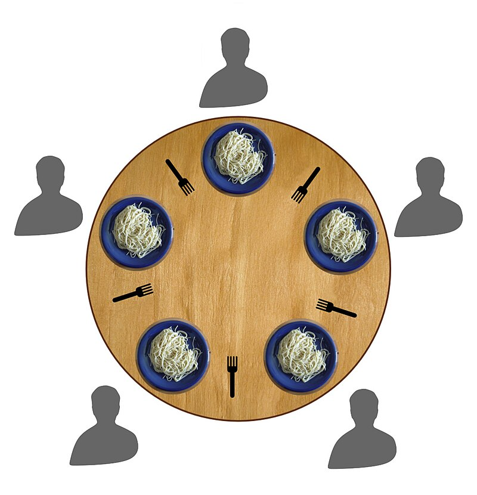{fig-align="center" fig-alt="diagram showing philosophers sitting at a round table, each has one item of cutlery at each side of their plate" width="90%"}
:::
::::
:::
:::::

## Dining philosophers and the circular wait

The Coffman conditions all hold!

- **Mutual exclusion**: one chopstick can be used by **at most one** philosopher at a time.
- **Hold and wait**: a greedy philosopher will not put down a chopstick once they have picked it up.
- **No pre-emption**: no waiter has ever been brave enough to take a chopstick from a hungry philosopher!

The disk writing deadlock was an example of circular wait.

## Preventing Circular Wait

- **Circular wait**

  each process in a circle is waiting for a resource that the next process has.

- **Solution**

  - Put an order on resources, e.g., $\underbrace{M_{1}<\cdots<M_{k}}_{\text{memory}}<\underbrace{D_{1}<\ldots<D_{\ell}}_{\text{disks}}<\underbrace{P_{1}<\cdots<P_{m}}_{\text{printers}}$.

  - A process can only access resources *greater than* the ones it already has.

## How does this prevent circular wait?

- Suppose $P_1$ has $D_1$ and wants $D_2$.

  It requests and gets access to \$D_1 \< $D_2$.

- It is impossible, if $P_2$ has $D_2$ for it to get $D_1$, since $D_1 < D_2$.

Circular dependencies are no longer possible.

- Same problems as with preventing hold-and-wait.

  - Inefficient use of hardware,
  - resources unknown so cannot request in ascending order,
  - sometimes degrades to "request all resources at once".

## Avoidance

- Don't let a situation arise where deadlock is possible.

  I.e., a request is refused if granting it could cause deadlock now or later.

- This is hard to do, since it's impossible to predict the future.

## Lab Work

- Split into 3 teams
- **Team A**: Dijkstra's Banker Algorithm

  What is it? What are the conditions needed for resources to be allocated? What are its limitations?
- **Team B**: deadlock detection

  What is a request resource allocation graph? How do they prevent deadlock? E.g. circular wait.
- **Team C** virtualisation

  What is resource virtualisation? Are there any drawbacks? Describe priority inversion.

# Next Time

Process protection

::: notes
## Dijkstra's Banker Algorithm

- Deadlock prevention algorithm based on the idea of a banker lending money.

- Each request must be

  - **feasible**: can be granted,

    e.g., it is impossible to allocate **100GB** of memory if the computer has only **16GB**.

  - **Safe**: there is no chance of deadlock if the request is granted.

- A very cautious approach:

  Maybe we get lucky 9/10 times and no deadlock happens, but the Banker will never grant the request.

## Limitations

The algorithm requires

- A **fixed number of resources**, which is often, but not always, true,
- A **fixed number of processes**, which is rare in a modern PC (no new processes, no processes can exit),
- Each process needs to know its maximum needs **in advance**.
- Safety decision is **computationally intensive**, and gets harder as more resources are added.
- Potentially **inefficient use of resources** due to the cautious approach.

## Detection and breaking

- It seems almost impossible to break the Coffman Conditions,
- Prevention, e.g., using the banker's algorithm, is limited and computationally difficult,
- Maybe it's **easier** and **cheaper** to spot deadlocks an fix them when they happen.

## Deadlock detection

Earliest method:

- Detection by operator,

  i.e., the operator notices the computer is hanging.

- EDSAC had an audio output, experienced operators could "hear" an infinite loop.

## Resource Request and Allocation Graphs RRAGs

A visual representation of **requests** and **allocations** or resources,

allows us to easily **spot deadlocks**.

- **Processes** are represented by squares,

  :::: cell
  ::: cell-output-display
  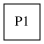{fig-alt="square with label P1" height="5%"}
  :::
  ::::

## RRAGs

- **Resources** are represented by squares (number represents how many of this resource there are),

  :::: cell
  ::: cell-output-display
  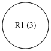{fig-alt="circle labelled R1 (2)" height="5%"}
  :::
  ::::

## RRAGs

- **Requests** by arrows from process to resource,

  :::: cell
  ::: cell-output-display
  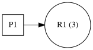{fig-alt="arrow from circle to square" height="5%"}
  :::
  ::::

## RRAGs

- **Allocations** by arrows from resources to processes,

  :::: cell
  ::: cell-output-display
  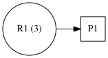{fig-alt="arrow from square to circle" height="5%"}
  :::
  ::::

## Example: successful request

- **Request**: Process P1 requests resource R1.

  :::: cell
  ::: cell-output-display
  {fig-alt="arrow from P1 to R1" height="5%"}
  :::
  ::::

- **Allocation**: Resource R1 allocated to process P1.

  :::: cell
  ::: cell-output-display
  {fig-alt="arrow from R1 to P1" height="5%"}
  :::
  ::::

## Example: unsuccessful request

:::: {.cell layout-align="center"}
::: cell-output-display
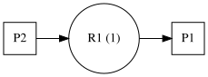{fig-align="center" fig-alt="arrow from R1 to P1" height="80%"}
:::
::::

- $P2$ requests resource $R1$.
- $R1$ is **already allocated** to $P1$.
- Therefore $P2$ is **not allocated** $R1$.

## Example: circular wait

:::: {.cell layout-align="center"}
::: cell-output-display
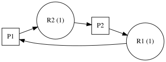{fig-align="center" fig-alt="P1 -> R1 -> P2 -> R2 -> P1" width="80%"}
:::
::::

- $R1$ allocated to $P1$; $R2$ allocated to $P2$.
- $P1$ then requests $R2$ and $P2$ requests $R1$.
- Neither request can be fulfilled.

Notice that **loops** in the RRAG indicate deadlocks.

## Breaking deadlock

- When a deadlock is detected, we know

  - the **processes involved**, and
  - the **resources involved**.

- But how can we break the deadlock?

  1.  **Kill the processes**,

  but which of the deadlocking processes to kill?

  - **Take the resource away**

    it may be possible to fix the deadlock by taking only some the resources away from some of the processes.

- the art is to kill as few processes and pre-empt as few resources as we can, but this is quite difficult.

## Exercise: dining philosophers

How might you break the deadlock in the **dining philosophers'** problem.

:::: {.cell layout-align="center"}
::: cell-output-display
{fig-align="center" fig-alt="diagram showing philosophers sitting at a round table, each has one item of cutlery at each side of their plate" width="35%"}
:::
::::

## A better solution: virtualisation

- A computer can create almost limitless "virtual" resources,

  e.g., virtual memory, printers, disks.

- Process uses them as though they are true resources.

- Later, the OS performs the operations done on the virtual resources on the real thing.

  New problem: resource scheduling. E.g., how to write data to disk most efficiently.

- with a mechanical HDD, having one write head, we can write most efficiently if the head moves around as little as possible.
- therefore, writes were re-ordered so that they could be performed most efficiently.

## Aside: hard disk drive at work

- [Video of a HDD reading and writing](https://upload.wikimedia.org/wikipedia/commons/transcoded/c/cf/HDD_Startup_and_Shutdown.webm/HDD_Startup_and_Shutdown.webm.1080p.vp9.webm)
- [Explanation of how a hard disk drive works](https://upload.wikimedia.org/wikipedia/commons/transcoded/f/f8/Harddrive-engineerguy.ogv/Harddrive-engineerguy.ogv.360p.webm)

A little aside, for those who are interested. Explaining how a HDD works.

## Priorities and no pre-emption

- Some resources cannot be pre-empted,

  e.g., if their state cannot be restored or the operation is destructive.

- Suppose a **low priority** process has a resource which a **high priority** process is blocking on.

- High priority process must **wait** for the low priority process to finish with the resource.

- However the low priority process is scheduled **infrequently**.

- In effect, the high priority process has been given **lower priority** than the low priority process.

This situation is called **priority inversion**.
:::

## Next time

Inter-process communication
