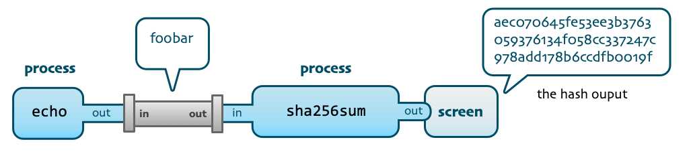
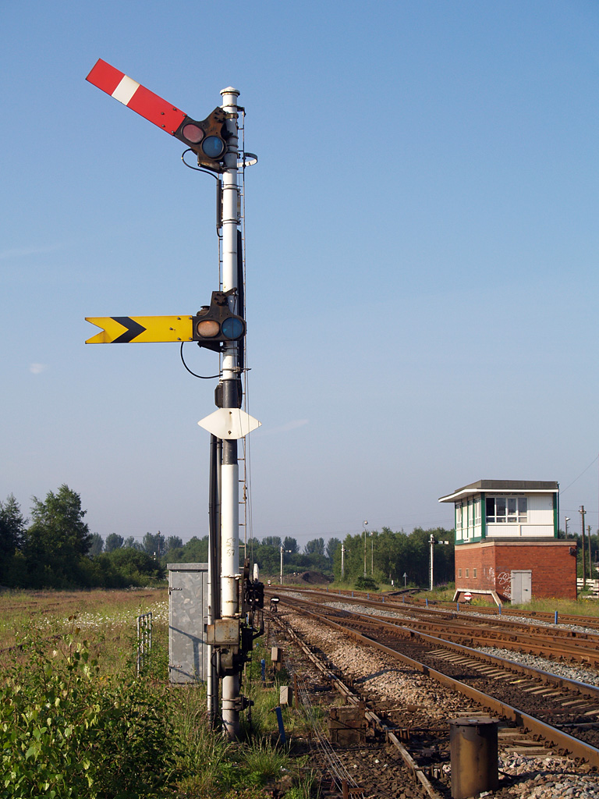
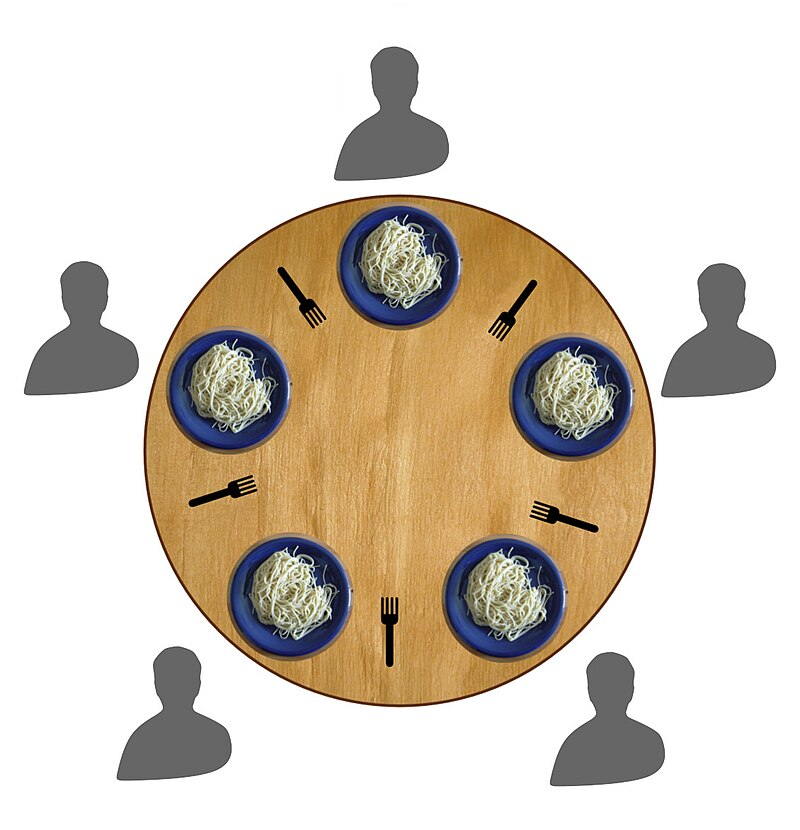

## Learning Outcomes

- Explain why **inter-process communication** is nedeed, and why it must be facilitated by the OS.
- Give an overview of **IPC mechanisms**, including how they work and their advantages and disadvantages.
- Describe what **POSIX** is, and state some of the things it defines.
- Use **POSIX pipes** to give the output from one process as the input of another.

## Recap: scheduling

- Deciding which process should run next.

- We studied many **scheduling algorithms**, the most complex of which was

  *Traditional Unix Scheduling*.

- A **pre-emptive** scheduler.

- Process priority computed **every second** from a

  *base value*, *CPU used* and optional *nice value*.

- System processes have **more base priority**.

- CPU usage **decays every 500ms** so

  processes which used **less CPU recently** are prioritised.

## Recap: scheduling

- Used in early Unix systems and Windows NT.

- However, not suitable for modern operating systems,

  since it does not scale well to large numbers of processes.

- Priorities are recalculated **all at once, every second**.

  - Takes a significant amount of CPU time,
  - Is not done often enough to reflect changes in behaviour.

## Recap: pitfalls of processes

As well as **scheduling processes**, the OS also has to:

- Prevent **deadlocks**,

  all processes waiting for one of their number to do something.

- Process protection:

  insuring that processes cannot interfere with one another.

## Recap: process protection

- Recall that each process is **owned by a user**.

- A user can mess with their own processes, but not the processes of other users.

- Provides **security**.

- A special user, called **root** can mess with the processes of **all users**.

- The MMU also provides a hardware solution to prevent one process from accessing another process's memory.

# Inter-process communication

## Inter-process communication

- The OS works hard to **isolate** processes from each another.

- What happens if one process needs to communicate with another?

- E.g., one process may need to tell another that a particular job, e.g., disk write, is done.

- Or a new process may need to tell the Window Manager to make a new GUI window.

## Inter-process communication

- OS facilitates communication between processes,

  but takes care to do this safely.

- Many methods of IPC, we will study a few:

  - Files,
  - Pipes,
  - Shared Memory,
  - Signals,
  - Semaphores.

## Files

::::: columns-2
::: column
- Possibly the simplest method of IPC,

  since it uses an existing mechanism.

  - Process $A$ writes data to a file,
  - Process $B$ reads the data.
:::
::: column
:::: {.cell layout-align="center"}
::: cell-output-display
{fig-align="center" fig-alt="file icon" width="80%"}
:::
::::
:::
:::::

## Files

- Which file should be used?

  - Communal IPC file,

    but if more than two processes are sharing data, how do we tell which bytes are meant for which process.

  - Then use one file per pair of processes,

    but some prior communication is needed to agree on a file.

- How does process $B$ know when process $A$ is finished writing?

- File *permissions* must be set correctly,

  so that the OS will allow both processes to access the file.

- Useful for sharing **large amounts** of data. 

## Pipes

- Two-ended, FIFO data structure.

- Allows **output** of one process to be used as **input** of another.

:::: {.cell layout-align="center" alt="a cartoonised unix pipe, showing how data comes out of one process and is passed into another as input"}
::: cell-output-display
{fig-align="center" width="90%"}
:::
::::

::: notes
- FIFO: first in, first out. Queue.
- You mau would have encountered this in a queue (real world and the datastructure), also pipelines.
:::

## Pipes

- Allow sharing data, similar to files,

  but provide **synchronisation**, too.

  - Process $A$ writes to the pipe,
  - Pipe becomes *full* (pipe can usually hold **4096 bytes**)
  - Process $A$ is blocked, process $B$ is scheduled,
  - Process $B$ reads data from the pipe,
  - When the pipe is **empty**, process $B$ is blocked.

## Pipes

- **FIFO**: data is read in the same order as it is written.

- Pipes are **unidirectional** (data flows in one direction), but two-way communication can be achieved with two pipes.

- Pipes affect scheduling, as they can **block** processes:

  it's possible to cause a **circular wait** with two pipes.

- Implemented as a **buffer** (block of memory managed by the OS).

## Exercise: POSIX pipes

- In Unix, the `|` character creates a pipe between two processes.

- E.g., on the command line, `$ ls -1 | grep foo`

  - `$` is the shell prompt.
  - `ls -1` lists all files in the current directory, one per line,
  - `|` takes this list of files (output of `ls -1`) and passes it to the next process,
  - `grep foo` filters the input, returning only lines containing `foo` -- in this case, it filters the files.

- play with pipes!

  Check out [this article on processes and pipes](https://itnext.io/unix-commands-pipes-and-processes-6e22a5fbf749).

## Shared Memory

::::: columns-2
::: column
- Similar to files, multiple processes read from / write to the same chunk of memory.
- Modern OSs prevent usually prevent this, so it has to be set up and managed by the OS.
- But shared memory is **much faster than files**.

:::
::: column
:::: {.cell layout-align="center"}
::: cell-output-display
{fig-align="center" fig-alt="icon indicating shared memory" width="80%"}
:::
::::
:::
:::::

## Shared Memory

- Same drawbacks as with files:

  - **Where** is the shared memory,

  - **When** should process $B$ start reading,

    I.e., how does it know that process $A$ has finished writing.

  - **Authorisation**: $A$, $B$ and **no other processes** should have access to the shared memory.

- Despite the drawbacks, it is still widely used due to its **speed**,

  but it is used alongside other **synchronisation mechanisms**.

::: notes
- needs synchronisation mechanisms, e.g., semaphores, which we'll talk about shortly.
:::

## Signals

- Software equivalent of **hardware interrupts**, i.e.,

  - process receives a signal,
  - stops what it is doing, saves its state, and
  - jumps to a **signal handler**.

- The **signal handler** is a piece of code, written by the programmer.

::: notes
- We said "the program stops what it's doing, saves it's state and jumps..." but really the OS manages all of this.
  - OS is responsible for sending, receiving and handling (either doing something or passing on to the process) all signals.
  - What really happens:
  - Signal dispatched (raised) via a syscall to the OS.
  - Signal is flagged in the receiving processes PCB (process control block).
  - Next time the receiving process is scheduled, the OS observes the signal flag and jumps to the signal handling code.
  - Once the signal is handled, the flag is removed so that next time the process is scheduled it runs from where it left off, before the signal was handled.
  - note that this means the programmer has to be careful when writing their code as signals can come at any time, so their program could be interrupted at any moment, and they have to be aware of any changes the signal handler has made.
  - concurrent programming is difficult and should be a module in its own right!
:::

## Signals

- The OS only allows signals to be sent to processes with **the same user ID**.

- Admin (the `root` user) can send signals to **any process**.

- The OS itself can send signals, too,

  e.g., to indicate that a peripheral is ready.

::: notes
- remember that signals are handled by the OS, so when we say "process sends a signal", we mean it makes a syscall and the OS handles the signal. OS performs user ID checking to see if the signal is permitted.
:::

## Signals

- All signals must go through the OS.

  - Provides **protection**:

    e.g., user ID checking.

  - Some signals have **specific behaviour which cannot be overridden**,

    e.g., `KILL` signal causes a process to be terminated immediately.

  - Signals are used by the OS if a process has done something bad, e.g.,

    - accessed memory it is not allowed to (`SIGSEGV`, segmentation fault),
    - tried to run a privileged operation (`SIGILL`, illegal instruction),

::: notes
- Note that some signals can be handled, or ignored, by the program.
- Others, e.g., KILL, SEGV, are handled by the operating system and usually result in the process being terminated.
- It is clear that one user shouldn't be able to signal other users' processes.
- This would allow one user to terminate another user's processes.
- It's also a reminder not to run as `root` unless you really need to, since you could accidentally do this!
:::

## Exercise: signals

- How many signals do you know?

- If you've ever managed your own memory, you've probably seen a SIGSEGV. What does it mean?
  
- Look up the different signals and find out

  - what they mean,
  - their default behaviour,
  - whether the default behaviour can be overridden by the programmer.

## Signals

- Widely used,

- They are fast and efficient,

- Only send a small amount of data,

- Asynchronous (can be sent / received at any time),

  which means they can be fiddly to program.

- Often used in conjunction with other IPC techniques,

## Semaphores

::::: columns-2
::: column
- A **flag** (variable) allowing synchronisation of processes.

- Another great invention of Dijkstra, who wrote

  "Go to sleep, we'll wake you up again when you need to continue."

- Two actions:

  - **Wait** (`P`) (also *signal*, *post*, *raise*, *up* and *unlock*),
  - **Signal** (`V`) (also *lower*, *down*, *lock*).

  Exercise: find out what **P** and **V** stand for -- Dijkstra is Dutch.
:::
::: column
:::: {.cell layout-align="center"}
::: cell-output-display
{fig-align="center" fig-alt="a person signalling with flags (semaphore language)" width="80%"}
:::
::::

- *Likely unrelated to the flag language*;

  probably from the Greek "apparatus for signalling".*
:::
:::::

::: notes
- Dijkstra, very famous Dutch computer scientist. We met him already when discussing the Bankers algorithm, but he's perhaps most famous for his shortest path algorithm.
- Unfortunately, it's probably not related to the flag language, a better analogy might be a railway signal. I.e., the train *waits* until they are *signalled* to go.
:::

## Semaphores

- One process often needs to tell another that it has finished a task,

  semaphores allow this.

- E.g., $A$ writes to an area of shared memory, then **signals** process $B$ using a semaphore,

  process $B$ **waits** for the semaphore, which opens when $A$ has finished with the memory.

::: notes
- signal with a semaphore means "do the raise, up, or V operation", and is not related to OS signals.
:::

## Semaphores

- Provide **synchronisation** and **mutual exclusion**.

  E.g., a train arrives at a Railway Semaphore,

::::: columns-2
::: column
- Attempts to **lower** (*wait*) for the Semaphore,
- Another train is using the track, so the operation is blacked and the train must wait.
- When track becomes free, semaphore is **raised** (*signalled*),
- Train **lowers** the semaphore and use the track,
- When finished, semaphore is **raises**.

:::
::: column
:::: {.cell layout-align="center"}
::: cell-output-display
{fig-align="center" fig-alt="photograph of a railway semaphore" width="60%"}
:::
::::
:::
:::::

## Semaphores vs signals

- OS signals are designed to alert a process of a specific event,

  e.g., a key press, or invalid memory access.

- Semaphores are specifically designed to implement

  synchronisation and **mutual exclusion**.

- A semaphore allows the process to "wait" for a certain event,

  e.g., a write to shared memory.

- Semaphores are **atomic**,

  - I.e., no scheduling happens between checking and setting the value of a semaphore.
  - Ensures no changes happen between checking and setting.

## Exercise: counting semaphore

::::: columns-2
::: column
- Counting semaphore:
  - The semaphore can be **raised** (or *signalled*) $N$ times,
  - Then it can be **lowered** (or *waited on*) $N$ times.
- Solve the **dining philosophers** problem using a **counting semaphore**.

:::
::: column
:::: {.cell layout-align="center"}
::: cell-output-display
{fig-align="center" fig-alt="diagram showing philosophers sitting at a round table, each has one item of cutlery at each side of their plate" width="90%"}
:::
::::
:::
:::::

## Semaphores

- Can be implemented in **hardware or software**.

  E.g., there are specific CPU instructions.

- Very fast with hardware support.

- Can be used to **protect shared resources**,

  both in the OS and in user-land.

- They are **low-level** and easy to get wrong:

  it's easy to cause accidental deadlock.

## Synchronisation mechanisms

- Some consider semaphores to be too low-level and complicated and proposed alternative approaches:

  - **Condition variables** can be used to tell a process when to proceed,
  - **Barriers** ensure all processes reach the same point in the code before any of them can continue (a synchronisation point),
  - **Monitors** are an object-orientated approach for indicating *critical regions* of code.

::: notes
- a critical region is a block of code which must be run all at once, with no scheduling, or multi-threading.
:::

## Exercise: POSIX

**POSIX** is a set of standard libraries implemented by some OS's.

- What does POSIX stand for?
- *Pipes* are part of POSIX, find five other things included in the POSIX standard that we've discussed in this module.
- Is the OS you are running POSIX compliant (or partially POSIX compliant)?

## Next time

Memory Management
