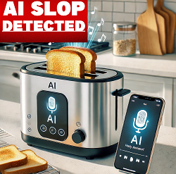
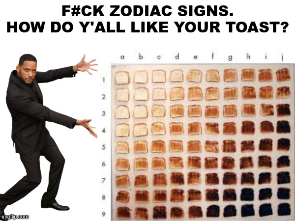
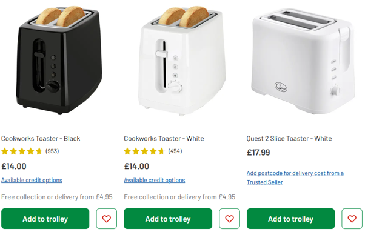

Many thanks to Ed Longford for the presentation and its evolution into a side rant on AI-powered toasters.

::: cell-output-display
{fig-align="center"
fig-alt="Staff photo of Ed Longford" width="40%"}
:::

# The Creative Process

Or at least a version of it

## There are many creative processes

This is the one Ed was told to teach his students, and the one I'll be teaching you. 

No, Ed is not being controlled by someone else… he does have free will...

Hollie, on the other hand...

# Steps of the Creative Process

# Requirements

## Requirements 

what do you want?

What do people want?

> Well, the simple answer is people are too stupid to know what they want.
> 
> I will come back to this point many, many times in the future

--- Dr Longford

## Example of people being stupid

I want AI built into my toaster!

Oh, what the place other than heaven – lets make a “smart” Toaster

::: cell-output-display
{fig-align="center"
fig-alt="Picture of an AI toaster with the text 'AI slop detected' edited on the top" width="40%"}
:::

## How do you like your toast?

::: {.cell-output-display}

{fig-align="center" width="80%"}

:::

## Let's make a list of requirements

### Obvious

- Toaster must be able to take 1 or more slices of bread and toast it

- Toaster must not burn peoples fingers off when touching the toaster while it is toasting bread

### Less Obvious (?)

- Toaster must not use more than 1KW of electricity when running

- Toaster must use AI to determine the correct level of tostiness for a 6-person household

## Functional vs Non-Functional 

### Functional

What the system should do

- Toaster must be able to accommodate 2 slices of standard sized bread

- Toaster must be able to detect the level of toastiness 

- Automatically switches off when toast reaches the correct level of toastiness

- Must have LED lighting system which can change colour depending on users mood

## Non-Functional

How the system should function

- Toaster should use less than 1KW of power

- Must meet current UK safety standards

- Casting and shape of the toaster must be attractive 

- Toaster should take no more than 5 seconds to reach desired temperature

- Internal camera must not degrade under normal heating conditions

## Feature creep

Sometimes when doing a project the requirements can grow

This can be because:

- The scope or funding improves

- People realise they can include additional things by doing things differently

- People are greedy and just want more stuff

# You know what would be “cool”?

## Custom images on toast?

- There is a hand mold toy that can be used to create images by pushing pins

  [[ Insert Hollie Baker side rant on the cost of refreshable Braille. ]]

- These pins could be heated to burn the toast 

- The images could be uploaded to the toaster

  WIFI? USB? Both?

::: notes
Hollie, if you are reading this, I am going to put some toast through the braille printer wish me luck (might have to make sure it's stale first)
:::

## Bread delivery drone

- Drone has to be small enough to fly around a kitchen

- Capable of visually identifying bread

- Capable of picking up bread without destroying it

# Planning

## Waterfall methodology

## Advantages

- Simplicity: Easy to understand, plan, and manage due to its rigid structure.

- Upfront Planning: Costs, timelines, and resources can be accurately estimated early on.

- Clear Milestones: Progress is easily measurable as each phase has a defined start and end.

- Strong Documentation: Creates a clear project record and knowledge base for future reference.

## Disadvantages

- Inflexible: Highly resistant to change—if requirements change mid-project, it requires extensive, costly rework of previous phases.

- Late Feedback: The customer only sees a working product and provides final feedback after the entire build is complete.

- High Risk: Major errors (e.g., misunderstanding requirements) are often discovered late in the testing phase, making them expensive to fix.

- Long Delivery: No working product is delivered until the very end.

## Agile Methodology

## Advantages

- High Adaptability: Teams can quickly and easily respond to changing requirements, market conditions, or customer feedback, even late in development.

- Reduced Risk: Frequent delivery of working increments allows defects and problems to be detected and fixed early, preventing minor issues from escalating.

- Increased Team Morale: Self-organizing teams have greater autonomy and ownership, leading to higher engagement and productivity.

## Disadvantages

- Lack of Predictability: The flexible scope and short-term planning make it difficult to accurately predict the final cost, schedule, and complete feature set at the start.

- Risk of Scope Creep: The emphasis on accepting change can, without strong product ownership, lead to uncontrolled additions of features, which balloon the project's scope.

- High Dependency on Customer: Success relies heavily on the Product Owner or client being available and committed to providing timely, clear feedback throughout every iteration.

## Design

## Conceptual diagram

## Physical Diagram

## Sequence diagram

- Sequence diagrams show the order that messages flow throughout a digital system, and which objects they interact with
- Sequence diagram notation
- Messages can also be returned to the same system object - so objects can message themselves (e.g. timer function) 
- Asynchronous messages are denoted by an open arrowhead. These messages do not require a response before the next message is sent

## Sequence diagram notation

Loops and alternative routes are denoted by boxes and a small label in the top left hand corner showing if it is a loop statement or an alternative route

## Communication diagram

- Communication diagrams are somewhere between a sequence diagram and a conceptual ERD diagram.

- They show the direction and flow of information through the system, but lays out the objects within a system in the style of an ERD

## Use Case Diagram 

- Use case diagrams map different user journeys throughout the system, detailing the main interactions between each user and the system. 

- It also shows where 2 or more users might interact with the same system component at the same time.

## Use Case Diagram 

- Stick figures are used to show users within the system

- Ovals are used to show system interaction points, they are not detailed software just descriptions of tasks users will do within a system

## Use Case Diagram 

- All system objects should be contained within a box to show this is the system they are interacting with. All users should be external to that system.

- Users are connected to these system objects via lines. There is no given order to the interactions listed.

## Use Case Diagram 

- System objects can have an extend or an include.

  - `<<extend>>` is another possible use case scenario that branches off the original 

  - `<<include>>` is where a use case requires another interaction to function properly

- The direction of the arrow shows the direction of the user journey so an invalid password goes to the user, buying a product takes the user to a login page

## Use Case Diagram 

- You can also show a mixture of generalised and child uses, where children either adopt parts of the parent or override parts of the parent.

- This example is where two different search categories change the behaviour of the parent

## Smart Toaster UML

## Results

- We now have a toaster, with an AI control system

- Including a heat reenforced camera to monitor the toast

- Onboard storage for different images for toast patterns

- A drone that flies around the kitchen

And Ha-Satan knows how many other features we’ve come up with

Total cost to customer: **£3,500**

## Is that a good deal?

::: cell-output-display
{fig-align="center"
fig-alt="Screenshot of cheap toasters on argos" width="80%"}
:::

::: notes
Is £3500 really an appropriate cost for a toaster?? When you can just buy one of these and it does the same job...
:::

## Everything went wrong

