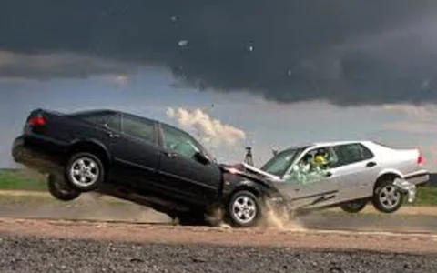
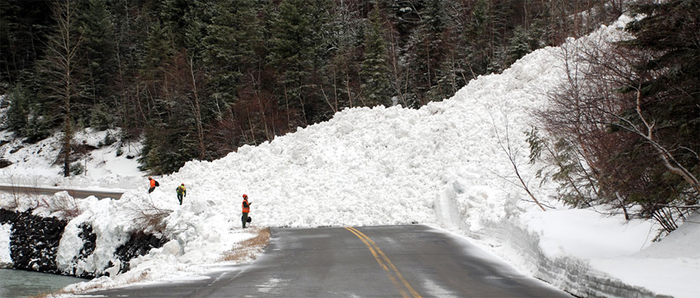

## Game Theory

The maths thing, not the other one

Massive thanks to Ed Longford, pro game theorist, for the material!

## Objectives

- Define game, player and strategy
- Classify toy problems and real world examples by game type
- Create payoff matrices for games and use them to analyse strategies

## What is it?

- Game theory is an area of study within mathematics (used by economists and political scientists) which builds models of human interaction

- It provides a mathematical foundation for generating predictions on group interaction

- Typically two-player games

  - A player in a game is a person or group of people that interact in the same social environment

  - They are normally restricted by the rules of the game (same as normal games) but only in the sense that we model their actions as 1 of several types of action

  - The assumption is that players are rational actors within the game. Reasonable? All people are rational...

## Types of game

- Three main categories, each with two types (taxonomy by Ed).

- Now always completely descriptive, but they do describe the mechanics and optima strategies to win. 

> Oh and I say “I break the games down”, because apparently I am an “expert” in this topic 

--- Ed

> He is. He did his PhD on it. No need to be humble, Ed.

--- Hollie

## Zero Sum Vs Plus Sum

- Zero Sum games are resource limited games. If one of the players wants to “win” or increase the amount of resources they have the other player(s) will either have fewer resources or none at all. So the gains of 1 player should equal the losses of the other.

- Plus Sum games, in contrast to zero sum games, allow resources to grow or allow players allocation of resources to be at a cheaper cost to each player.

## Cooperative Vs Non-Cooperative

- Cooperative or non-competitive games are where players are encouraged to work together.

- Non-cooperative or competitive games are where players are encouraged to behave selfishly.

## Simultaneous Vs Sequential

- Simultaneous games are where players all make their move concurrently, or without knowledge of the other player(s) move(s).

- Sequential games happen when each player takes turns making moves, and each player knows what the last move was before they need to decide what move they are going to make.

---

These are not individual game types

Most games are a combination of those three categories.

- Noughts and Crosses, Chess, and Go are competitive, zero sum games which are played sequentially.

- Some games switch between different categories: they might start cooperative and then become non-cooperative - for example Diplomacy 

## Information - complete or incomplete

- Games contain information - both about the other players and the game rules

- Information is either complete or incomplete - i.e. you either know everything or have limited knowledge

- Chess is an example of a complete information game as you can know all the possible moves the other player can make

## Payouts and Cost

- In games players are awarded a number of points (a payout) for winning the game 

- Sometimes actions in a game come with a cost of action this means that each action in the game will force the player to use up some resources to perform said action. 

- Costs are common in most scenarios, e.g. coming to S&A has a cost of not doing something else more fun! 

  > Hey, Ed, are you trying to say my classes are no fun? Actually, don't answer that, please.

- Payouts can either be symmetric or asymmetric

## So either players can have the same payout and cost for each action, or different players have different payouts and costs for each action 

- Which means that games are not always fair for all players, 

- Hovewer, games can be fair while having different costs and payouts. More on that shortly.

## Number of plays - 1 shot or repeated

- Games are either 1 shot (take place only once) with the same players

- Or repeated games where games take place multiple times with the same players

- Sometimes repeated games are none-continuous games (players are returned to their original start positions) or continuous so any cost or payouts from previous games are carried forward

## Games we are going to cover

- Chicken 

- Prisoner's Dilemma 

- Auction 

- Snowdrift 

Note: Other games exist, but many games are just variations of these or games that cover rare examples.

The games we cover today are applicable to most situations and can be modified to meet the needs of the players and situation 

## 1. Chicken

::: columns
::: column
- Chicken is a zero sum, non-cooperative, and simultaneous game 

- The original scenario is 2 cars driving at each other and each driver has a choice to swerve or continue driving straight.
:::
::: column
{figalt="Car crash"}
:::
:::

## Chicken Payout Matrix

|     | Swerve | Straight |
|:---:|:------:|:--------:|
| Swerve | 0, 0 |	1, 0 |
| Straight |	0, 1	| -1000, -1000 |

## Cold War - a game of nuclear chicken

- American advisors used chicken to determine how to negotiate with the USSR

- Cuban Missile Crisis (1962)

  - 8th September Soviet deliver medium range missiles with nuclear warheads capable a striking Washington DC

  - Missile sites spotted by U2 spy planes October 19th

---

{fig.alt="Cuban missile crisis tree"}

::: notes

:::

## US came up with 6 options 

1. Do nothing: American vulnerability to Soviet missiles was not new.

2. Invasion: Full-force invasion of Cuba and overthrow of Castro.

3. Air strike: Use the US Air Force to attack all known missile sites.

4. Blockade: Use the US Navy to block any missiles from arriving in Cuba.

5. Secret approach: Offer Castro the choice of splitting with the Soviets or being invaded.

6. Diplomacy: Use diplomatic pressure to get the Soviet Union to remove the missiles.

# Which option?

## What happened?

US chose Blockade

US deployed 12 destroyers for the initial blockade ordered to stop and search all ships heading to the northern Caribbean this was later scaled to 1 aircraft carrier, 2 cruisers, 22 destroyers, and 2 guided missile frigates

Soviets deployed an unknown number of submarines armed with nuclear weapons and over 40 warships of various sizes 

Each side increased both military and diplomatic efforts to force the other to swerve - US goes to DEFCON 2 (DEFCON 1 is where nuclear weapons are launched) 

## What happened?

Germany and China mobilise troops to prepare for invasions 

Soviet Union backs down

After several games of chicken, the USSR swerves and agrees to withdraw its missiles from Cuba

The ships carrying the missiles are turned around and head back to their home ports

The US claims victory and its allies breathe a sigh of relief as the world did not end in a nuclear holocaust or invasion of US and Europe

## What happened?

... or did they? Secret Negotiations

There is 1 part that is often left out of the story

While each side was ramping up world tension (driving straight) members of the KGB were in contact with members of the CIA, FBI, and US State Department seeking a diplomatic solution

And the game transformed from Chicken to Prisoner’s Dilemma.....

## 2. Prisoner’s Dilemma

Prisoner’s Dilemma is a zero sum, cooperative/non-cooperative, and simultaneous game 

2 prisoners are arrested by the police, placed in separate rooms and given a choice

- Say your partner committed the crime and get set free, 

- or say nothing and go to jail

## Prisoner’s Dilemma Payout Matrix

|     |	Stay Silent	| Betray |
|:---:|:-----------:|:------:|
| Stay Silent |	2, 2 |	0, 10 |
| Betray | 10, 0	| 5, 5 |

## Both sides were willing to cooperate from the outset

Instead of playing chicken and driving headlong into a war, both the US and USSR were cooperating for the majority of the crisis, with a few minor defections along the way

A good indication that they were playing Prisoner's Dilemma is the outcome:

Yes, USSR missiles were removed from Cuba, but US missiles were removed from Italy and Turkey as part of the exchange. 

## 3. Auction Games

Also known as bidding games

- There are a wide range of auction games, each has a variety of rules, each changing their overall strategy

- Most start off with 2 or more players with a set amount of resources and 1 or more items for each player to bid on to win

## Some auction types

- Single Blind Bid - all players bid for a single prize but they do not know the value of the prize

- Single Visible Bid - all players bid for a single prize knowing the value of the prize

- Multiple Blind Bids - All players bid for multiple prizes but do not know the value of any prize

- Multiple Visible Bids - Players can bid on a number of prizes where they do know the value

## Cost of bidding

Depending on the game rules, when a player bids they might lose their bid regardless of whether they win or lose. Think of this as the cost of time for doing a certain action - e.g. writing a piece of code for an assessment 

Additionally, some games are simultaneous, so all bids must be placed before the game starts so each player cannot change their bids after the game begins - again like assessments

## Example: 2 visible single bid

- Two boxes: £9 and £15

- 3 players each have £10 to bid on 2 prizes

- You will lose whatever you bid

- How much do you bid on each box? 

## Possibilities?

- Well there is no point in spending more than £9 on the first prize

- But if you place too high a bid on the £9 prize then you probably won’t win the 2nd prize of £15 which is higher than your initial starting bid so you should put more money on the 2nd box

- But what if other players also think this? So perhaps placing more money on the 1st prize increases your chances of winning?

## Player Choices

|     |	Prize 1 (£9) bid | Prize 2 (£15) bid | Max Payout |
|:---:|:----------------:|:-----------------:|:----------:|
| Option 1 | £10 |	£0 | -£1 |
| Option 2 | £7 | £3 | £14 |
| Option 3 | £5 | £5 | £14 |
| Option 4 | £3 | £7 | £14 |
| Option 5 | £0	| £10	| £5 |

## Payouts depend on other player choices 

|	      | Prize 1 (£9) bid	| Prize 2 (£15) bid |	Max Payout |
|:-----:|:-----------------:|:-----------------:|:----------:|
| Option 1 | £10 (£5)	| £0 (£5) |	-£1 (£10) |
| Option 2 | £7 (£5) | £3 (£5) | £2 (£10) |
| Option 3 | £5 (£5) | £5 (£5) | £0 (£0) |
| Option 4 | £3 (£5) | £7 (£5) | £8 (£4) |
| Option 5 | £0 (£5) | £10 (£5) | £5 (£4) |

Here player 2 splits their bid £5 for each prize

## Payouts depend on other player choices 

|      | Prize 1 (£9) bid	| Prize 2 (£15) bid	| Max Payout |
|:----:|:----------------:|:-----------------:|:----------:|
| Option 1 | £10 (£3) | £0 (£7) | -£1 (£8) |
| Option 2 | £7 (£3) | £3 (£7) | £2 (£8) |
| Option 3 | £5 (£3) | £5 (£7) | £4 (£8) |
| Option 4 | £3 (£3) | £7 (£7) | £0 (£0) |
| Option 5 | £0 (£3) | £10 (£7) | £5 (£6) |

Here player 2 splits their bid £3 for the first prize and £7 for the second 

## Payouts depend on other player choices 

|     | Prize 1 (£9) bid | Prize 2 (£15) bid | Max Payout |
|:---:|:----------------:|:-----------------:|:----------:|
| Option 1 | £10 (£7) | £0 (£3) | -£3 (£10) |
| Option 2 | £7 (£7) | £3 (£3) | £0 (£0) |
| Option 3 | £5 (£7) | £5 (£3) | £10 (£2) |
| Option 4 | £3 (£7) | £7 (£3) | £8 (£2) |
| Option 5 | £0 (£7) | £10 (£3) | £5 (£2) |

Here player 2 splits their bid £7 for the first prize and £3 for the second 

## Payouts depend on other player choices 

|     |	Prize 1 (£9) bid | Prize 2 (£15) bid | Max Payout |
|:---:|:----------------:|:-----------------:|:----------:|
| Option 1 | £10 (£10) | £0 (£0) | £0 (£0) |
| Option 2 | £7 (£10) | £3 (£0)	| £12 (-£1) |
| Option 3 | £5 (£10) |	£5 (£0)	| £10 (-£1) |
Option 4 | £3 (£10) | £7 (£0) | £8 (-£1) |
| Option 5 | £0 (£10) | £10 (£0) | £5 (-£1) |

Finally player 2 is bad at maths and splits £10, £0

## However

- While we have added a value to each prize, the prizes might not be worth the same to each player

- That £9 item might be worth more to a player if it happens to be a limited edition collectable (personal value) or a value that changes over time

- And the stake of £10 is not the same value either, £10 for someone with a £80,000pa income is worth less than someone on £15,000pa

# Which choice is optimal?

## Auction games give us 3 strategies 

- To win as much as possible

- Minimise the other players winnings 

- Deciding not to play as the winnings do not outweigh the costs

## But we need to know the rules before we can work out what is best

Auction Game Alternative rules

- Only pay if you win the prize

- Pay the 2nd highest bid if you win a prize

- Bidding is done sequentially

- Prizes are divided based on bid contributions

## 4. Snowdrift

::: columns
::: column
Cooperative, plus sum, simultaneous

You are out driving in a car when suddenly an avalanche blocks the road, both in front and behind you.

You are stuck and cannot drive around. You are 50 km from the nearest shelter and will die if you stay in your car as temperatures are due to drop sharply overnight 

Your only choice is to clear the snow before you freeze to death…
:::
::: column
{fig.alt="Road blocked after avalanche"}
:::
:::

## Shared costs and payouts

There is physical effort required to clear the snow, but you will get to save your life

If there are 2 people clearing the snow, then it will be less effortful for each of you to clear the snow and you can both drive to safety

However, if you stay in the car and let the other person clear the snow, you can still drive to safety, but you also got to stay in your warm car.

## Snowdrift Payout Matrix

|     | Stay in Car | Clear Snow |
|:---:|:-----------:|:----------:|
| Stay in Car |	-1000, -1000	| 100, 300 |
| Clear Snow | 300, 100 |	200, 200 |

## Game Theory, what is the point?

Game theory allows us to create a series of mathematical rules to simulate social situations 

We can use this to create AI systems to interact with or monitor human behaviour, and even predict future events

We can also develop strategies to work out how best to play these games ("toy problems" that reflect real-world scenarios).

## Game Strategies

- Cooperator - A player that always cooperates  

- Cooperator Spite - A player that starts off cooperating, then on turn 3 defects for the rest of the match 

- Defector - A player that always defects. 

- Random (0.2, 0.5, and 0.8) - A player that chooses randomly with a bias towards cooperation modifier of either 0.2, 0.5, 0.8.  

- Spiteful Tit for Tat - A player that will cooperate, but will defect permanently after the other player defects twice in a row. 

- Tit for 2 Tats - A player that mimics the last pair of moves from the other player, or returns previous action. 

## Game Strategies

- Tit for Tat - A player mirrors the actions of the other player. 

- Tricky Cooperator - A cooperator that will occasionally defect to improve payout. 

- Tricky Defector - A defector that will occasionally try to trick the other player into cooperating to improve payout. 

- Two Tits for Tat - A player that will defect twice each time the other player defects. 

- Tit for Tat Grim - A player that will mimic the lowest cooperation level, e.g. if player plays C, C, D, C, C then this strategy will play C, C, D, D, D. 

## Summery

- All games are combination of: Cooperation/non-cooperation, sequential/simultaneous, and plus/zero sum

- Games are further developed by level of information, payout and costs of actions, symmetry of these payouts/costs, and how many times the game is played

- All situations can be modeled as different sorts of games, and this allows us to build mathematical models out of them

## Lab work 

Play the games we have learnt today with other groups, and try to earn more points for your table.

## Game 1 Chicken

If after 3 turns you are both going straight, both teams lose 

|     | Swerve | Straight |
|:---:|:------:|:--------:|
| Swerve | 0, 0 | 10, 0 |
| Straight | 0, 10 | -30, -30 |

## Game 2 - Prisoner’s Dilemma 

Note that payouts are negative 

|     |	Stay Silent |	Betray |
|:---:|:-----------:|:------:|
| Stay Silent | -5, -5 | 0, -20 |
| Betray | -20, 0 | -10, -10 |

## Auction game

|     | Box A | Box B | Box C |
|:---:|:-----:|:-----:|:-----:|
| Round 1 | 10 | 20 | 10 |
| Round 2 | 40 | 10 10 |
| Round 3 | 15 | 15 |30 |

## Lab work

Identify the games that best fit 5 scenarios - I will give you 3, you have to decide on 2 others

- Buying a car

- Splitting time between university work and social activities

- Applying for jobs

- +2 more you came up with on your own

## Next time

Deadlock,

... and then Then we put the game theory into practice by playing negotiating nations!
