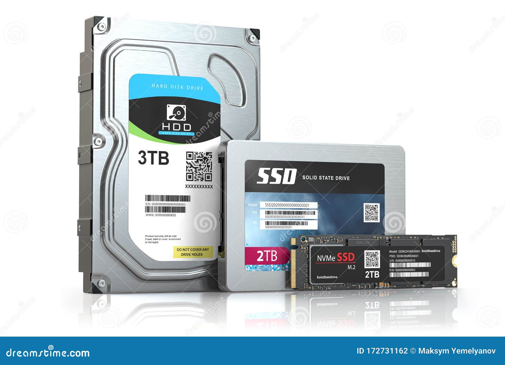
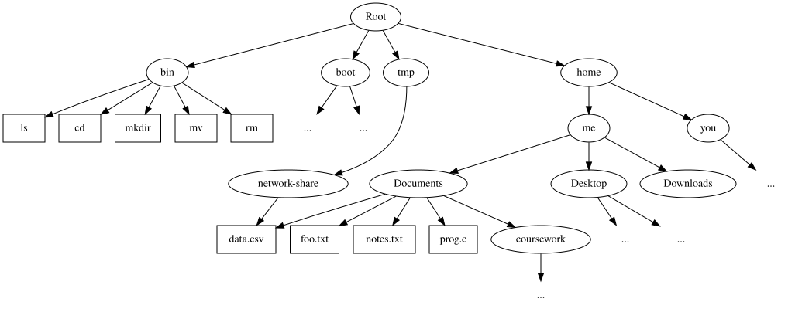

## Objectives

- State the difference between a **file** and a **filesystem**.

- Recognise the actions a filesystem must be able to perform, and the proporties it should have.

- Work with files in a Unix-based operating system: know how to perform the filesystem operations on the command line.

- Explain how the **directory structure** and **Inodes** are used in the Traditional unix Filesystem,

  and explain some of the implications, e.g., to uniqueness of files, and what happens when a file is deleted.

- State the principles of the **Unix philosophy** and give examples of how Unix-based operating systems embrace them.

33 Recap: operating systems

- Just another **program**.
- Provides a **programming interface** for the computer hardware.
- Responsible for **managing** (protecting) **resources**.

## Recap: resources

So far, we have looked at

- The **CPU**: process scheduling.

  *Which process should be run next.*

- Also provides **protection** -- processes should not interfere with one another.

- Facilitates **inter-process communication**, allowing processes to coordinate and share data safely.

- Prevents or breaks **deadlocks**.

## Recap: resources

So far, we have looked at

- **Manages memory**, by ensuring each process is allocated a contiguous block and isolating one process's memory from that of another.

- Virtual memory:

  - block appears contiguous even though physical memory may not be,
  - isolation, since process appears to have exclusive access to memory, but all accesses are translated by the OS or hardware.
  - shared data and code, simply by mapping the same areas of physical memory to different processes.

## Persistent storage

::::: columns-2
::: column
- Main memory is **volatile**, meaning data is lost when the computer is switched off.

- We need a means of **persistently** storing data.

- Persistent storage should be much larger than main memory,

  it should therefore be **cheap**, but this makes it **slow**.

:::
::: column
:::: {.cell layout-align="center"}
::: cell-output-display
{fig-align="center" fig-alt="photograph of a hard-disk-drive and a solid-state-drive" width="90%"}
:::
::::

- Historically **magnetic tape**, then **spinning hard disk drives**, now **solid state storage** is commonplace.
:::
:::::

# Files and Filesystems

## Filesystems

- A means of **organising data**,

  different from **disks**, which are a place to store data.

- Some applications benefited from **direct access to disk**,

  e.g., database software can work optimally if it has direct access to the hardware.

- Filesystems can also be used to organise main memory, and can be used to organise data other than files.

## Files

::::::: columns-2
::: column
- A collection of bytes stored on disk.

- Humans like memorable names,

  so we like to give each collection of bytes a name.

- We also like to **organise** our names,

  this is done using *directories*.

:::
::: column
:::: {.cell layout-align="center"}
::: cell-output-display
{fig-align="center" fig-alt="photograph of piles of unorganised papers" width="70%"}
:::
::::

*Much easier to find things when they are well-organised.*

:::: {.cell layout-align="center"}
::: cell-output-display
{fig-align="center" fig-alt="photograph of organised drawers of index cards" width="70%"}
:::
::::
:::
:::::::

## Data and names

::::: columns-2
::: column
- The same chunk of data may have multiple names.
- I.e., multiple *pointers* to the **same file**.
- E.g., *Lewis Carole* and *Charles Dodgson* are two different names for **the same person**.

:::
::: column
:::: {.cell layout-align="center"}
::: cell-output-display
{fig-align="center" fig-alt="picture of Charles Dodgson" width="50%"}
:::
::::

*Author (of Alice Through The Looking Glass, The Jabberwocky and others), also a mathematician.*
:::
:::::

## Directories; a recursive datastructure

::::: columns-2
::: column
- Files are organised into directories.
- A directory may contain **files** or **other directories**.
- Directory structure is a **directed acyclic graph**.

:::
::: column

:::: {.cell layout-align="center"}
::: cell-output-display
{fig-align="center" fig-alt="directed acyclic graph representing unix file hierarchy" width="95%"}
:::
::::
:::
:::::

##POSIX paths

::::: columns-2
::: column
- **Root directory**: unique node at the top of the tree,

  Represented as `/`.

- The **same** filename can appear in **multiple directories**.

- A **directory name** may appear in **exactly one** directory.

- *POSIX paths* separate directories by `/`,

  other Filesystems may use different separators, e.g., `\`.

:::
::: column

:::: {.cell layout-align="center"}
::: cell-output-display
{fig-align="center" fig-alt="directed acyclic graph representing unix file hierarchy" width="95%"}
:::
::::
:::
:::::

## Exercise: directed acyclic graph

::::: columns-2
::: column
- Why is a **directed acyclic graph** a good representation for file hierarchy.

  *Hint*:

  - Acyclic means **no loops**,
:::
::: column

:::: {.cell layout-align="center"}
::: cell-output-display
{fig-align="center" fig-alt="directed acyclic graph representing unix file hierarchy" width="95%"}
:::
::::
:::
:::::

## Trees

- A **tree** structure is similar, but does not allow two links to the same node.

  Why can Filesystems not be represented as a tree?

::: notes
- directed acyclic graph.
  - directed: can only go in direction of arrows. i.e., defines the hierarchy.
  - acyclic: no loops allows us to traverse the filesystem and always end up somewhere. i.e., cannot get stuck in a loop searching for a file.
  - not a tree: since the same name can exist in multiple directories.
:::

## Capabilities

Every filesystem must be able to:

:::: columns-2
::: column

### Files

- create a new file,
- delete a file,
- open a file,
- read data from a file,
- write data to a file,
- close an open file,

::: 
::: column

### Directories

- create a new directory,
- delete a directory,
- find a directory / file name within a directory,
- add a file to a directory,
- remove a file from a directory,
- rename a file.
:::
::::

::: notes
- note that renaming a file is a directory operation, not a file operation.
:::

## Capabilities

- Speed of access and speed of update,
- Scale well to large numbers of files,
- Use disk space efficiently,
- Work reliably (ensure integrity of data),
- Provide protection and security,
- Facilitate backup and recovery.

Remember, as with operating systems

- *A good filesystem is the one you forget is there.*

::: notes
- remember that Filesystems, like operating systems, must be fast, efficient and helpful (i.e., they should take fiddly work away from the programmer and give them a simple interface). Same philosophy applies: a good filesystem is the one you forget is there.
:::

## Byte-orientated

- Early Filesystems used **records**,

  fixed size objects with some structure.

- Hangover from the days of index cards / punched cards.

- Modern files have no structure and arbitrary size.

- Files are simply arrays of bytes stored on disk,

  i.e., can be defined by data locations on disk.

## Traditional Unix Filesystem

- A file is just an array of bytes,

  so we need to know where to find the bytes on disk.

- But the OS also needs some other information.

  Stored in a datastructure called an **Inode**.

## Inodes

Inodes store:

- size,
- timestamps (date created / last modified),
- type (file, directory, or something else),
- ownership (user ID),
- permissions (which users can read, write, and run the file),
- reference count (how many names does the file have),
- array of bytes where file content can be found.

::: notes
- is anything important missing from the Inode data structure?
- file names? (they do not belong in the Inode, as we will see shortly)
:::

## File names

- Inode are a **fixed size** and can be stored as a simple array on disk.

- Each Inode can be uniquely identified by its position in the array (Inode number).

- Inodes **do not include filenames**.

- Instead, filenames are stored in directories:

  each entry is a pair: `name, Inode_number`.

- Every directory contains two special entries:

  - `..` refers to the parent directory,
  - `.` refers to the directory itself.

## Locating a file

`/home/me/Documents/foo.txt`

- **Root**: `/, 0`

- Inode **0** is a directory:

      bin, 1
      boot, 2
      dev, 3
      etc, 4
      home, 5
      lib, 6
      tmp, 7
      usr, 8
      var, 9

## Locating a file

- Locate the *home* Inode:

  index **5**.

- It is another **directory**:

        Desktop 10
        Documents 11
        Downloads 12
        Dev 13

- Locate the *Documents* Inode:

  index **11**.

## Locating a file

- It is another **directory**:

        Coursework 14
        data.csv 15
        foo.txt 16
        notes.txt 17
        prog.c 18

- Locate the *foo.txt* Inode:

  index **16**.

## Locating a file

- It is a **file**:

        size: 4KB,
        timestamps: created at Jun 22 06:58,
        type: file,
        ownership: 2001 (me),
        permissions: -rw-rw-r--,
        reference count: 1,
        content: 1024, 1025, 1026, 1027, ...

- Given the inode, any file operation can be performed.

- Note: we can also **traverse upwards** using `..`.

## Linux, full stops and hidden fgiles

- The `.` and `..` are hidden when listing files on the command-line and by default in most file managers.
- Actually, any file that begins with a '.' is hidden.
- People use this to their advantage, and often name configuration files / directories so that they will be hidden

  - '.bashrc'
  - '.ssh'.
  
## Ed Rogers' side rant
  
> The notion that filenames preceded by a . should be hidden is the result of a software bug in the early days of Unix. When the special . and .. directory entries were added to the filesystem, it was decided that the ls command should not display them. However, the program was mistakenly written to exclude any file whose name started with a . 
  
Or was it just lazy programming?

::: notes
source:https://en.wikipedia.org/wiki/Hidden_file_and_hidden_directory
:::

## 8.3 Filenames

- Filename rules from CP/M, old versions of DOS and pre Windows 95 / Windows NT 3.I
- Still implemented in modern Windows for compatibility with old apps.
- According to [OS News](https://www.osnews.com/story/146073/windows-legacy-8-3-filename-support-actually-negatively-affects-performance/), modern Windows still generates 8.3 filename aliases, has a negative impact on performance. 

## 8.3 filename specification

- Only uppercase
- At most 8 characters after the directory specifier
- optional dot plus up to three character file extension
- E.g., `MYFILE.TXT`
- Similar to [ISO9660](https://www.osnews.com/story/146073/windows-legacy-8-3-filename-support-actually-negatively-affects-performance/) usef for CD-ROMs

## Windows Path Name Length Limit

- `MAX_PATH_LENGTH` in the Windows API is $260$ characters.
- It seems long, but this can quickly get used up with an organised directory hierarchy.
- Has caused problems with Google Drive and similar failing to sync to Windows machines because names were too long. Now G Drive enforces this limit to avoid the problem.

## Reserved filenames

- In early DOS, devices were exposed as special filenames
- For backwards compatibility, Windows won't let you name a file

- CON, PRN (default printer), AUX, NUL (discard everything written)
- COM0 through COM9 (serial ports)
- LPT0 through LPT9 (parallel ports(

- Trying to name, e.g., `NUL.txt` also fails, but you can bypass WIN32 path parsing with, e.g., WSL.

## Deleting a file

- A file can be **removed from a directory**.

  - Decrease the **reference count**,
  - Remove the name from the directory.

- If reference count reaches $0$:

  - *free* the Inode,
  - *free* the disk space.

- Note that deleting a file may not remove its content from the disk.

::: notes
- when reference count drops to zero, the disk space is simply "freed" so that it can be overwritten by another file.
- the files bytes may hang around on disk for a while.
- this is how data recovery tools work, but also has implications for cyber security.
:::

## Disk blocks

- Analogous to a **page of memory**,

  i.e., a bunch of bytes on disk.

- It is sensible to group all data in the same file together on a **hard-disk-drive**.

  This minimises movement of the read/write head.

- Exercise: is this still necessary (or beneficial) on solid state drives?

## Caching

- Remember: main memory is very slow compared to CPU.

- Disks are **orders of magnitude slower** than main memory.

- Thus OS's cache Inodes, and even data in main memory to increase speed.

- Sometimes data is not written to disk immediately,

  this is why it is best not to pull out a USB drive unless OS says "safe to remove".

## Exercise: the linux command line

# The Unix Philosophy

## The Unix Philosophy

::::: columns-2
::: column
Principles on which the UNIX OS was built:

- Proposed by Ken Thompson.
- Promotes **minimalist**, **modular** software development.

:::
::: notes

:::: {.cell layout-align="center"}
::: cell-output-display
{fig-align="center" fig-alt="photograph of Ken Thompson" width="80%"}
:::
::::

*Ken Thompson developed the original Unix OS at Bell Labs.*
:::
:::::

## The Unix Philosophy

Four principles:

1.  Make each program do one thing well. To do a new job, build afresh rather than complicate old programs by adding new "features".
2.  Expect the output of every program to become the input to another, as yet unknown, program. Don't clutter output with extraneous information. Avoid stringently columnar or binary input formats. Don't insist on interactive input.
3.  Design and build software, even operating systems, to be tried early, ideally within weeks. Don't hesitate to throw away the clumsy parts and rebuild them.
4.  Use tools in preference to unskilled help to lighten a programming task, even if you have to detour to build the tools and expect to throw some of them out after you've finished using them.

## The UNIX philosophy

In their Unix paper of 1974, Ritchie and Thompson quote the following design considerations:\[3\]

- Make it easy to write, test, and run programs.
- Interactive use instead of batch processing.
- Economy and elegance of design due to size constraints ("salvation through suffering").
- Self-supporting system: all Unix software is maintained under Unix.

## Pipes and the Unix Philosophy

- Unix philosophy as summarised by Peter H sallus:

  - Write programs that do one thing and do it well.
  - Write programs to work together.
  - Write programs to handle text streams, because that is a universal interface.

- Earlier, we explored **pipes**'

  A way of using the output of one process as the input of another.

- Pipes allow us to combine several programs which **do one thing** very well.

- Text streams are used as the **output and input** of most unix programs, meaning they can **work well together**.

- We will see shortly that everything in Unix is a file, another common interface.

## Exercise: everything is a file

- File redirection.

- Special files (which aren't really files),

  - `stdin`, `stdout` and `stderr`,
  - `/dev/null`, `/dev/zero`, `/dev/random`.
